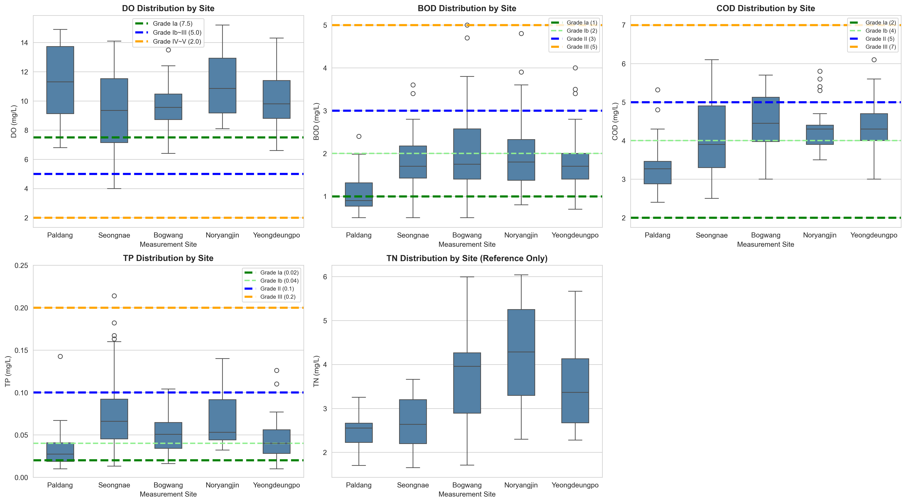

# 한강 수질 오염 분석

한강 5개 측정 지점의 2023년 7월 ~ 2026년 4월(34개월) 수질 데이터를 **EDA → 지점별 비교 → 시계열 분석** 순서로 분석한 환경 데이터 프로젝트입니다.

성내천(지류)은 DO가 가장 낮고 TP가 가장 높았습니다. TN은 중류 노량진에서 가장 높았고, 상류 팔당댐2 대비 약 1.7배였습니다.


---

## 개요

- **동기:** 환경부 물환경정보시스템의 한강 수계 공개 데이터로 공간적·시간적 수질 패턴을 함께 분석해 보고자 했습니다.
- **목표:** 상류에서 하류로 갈수록 수질이 어떻게 달라지는지, 그 차이가 어느 지점에서 두드러지는지 확인합니다.
- **데이터:** 한강 5개 측정 지점(팔당댐2, 성내천, 보광, 노량진, 영등포), 2023년 7월 ~ 2026년 4월 (34개월)

---

## 데이터

- **출처:** [물환경정보시스템](https://water.nier.go.kr/)
- **데이터 기간:** 2023년 7월 ~ 2026년 4월 (34개월)
- **분석 데이터:** 지점당 34개 측정일, 총 170행
- **행의 의미:** 1개 지점의 1개 측정일 평균값 (같은 날짜의 여러 측정값을 평균)
- **측정 항목:** 아래 5가지 수질 지표. DO는 높을수록, 나머지 지표는 낮을수록 수질이 좋습니다.

| 항목 | 의미 |
|------|------|
| DO (용존산소) | 물속에 녹아 있는 산소량 |
| BOD (생물화학적 산소요구량) | 미생물이 물속 유기물을 분해하는 데 필요한 산소량 |
| COD (화학적 산소요구량) | 화학약품으로 물속 유기물을 산화하는 데 필요한 산소량 |
| TP (총인) | 물속 인의 전체 농도. 녹조를 일으키는 주요 원인 |
| TN (총질소) | 물속 질소의 전체 농도. 녹조를 일으키는 주요 원인 (환경기준 없이 참고용) |

### 측정 지점

| 지점명 | 위치 | 특징 |
|--------|------|------|
| 팔당댐2 | 상류 | 팔당댐 직하류, 분석의 기준 수질 |
| 성내천 | 지류 | 한강 합류 직전 소하천 |
| 보광 | 중류 | 한강대교 부근 |
| 노량진 | 중류 | 한강 중·하류 경계 |
| 영등포 | 하류 | 서울 서부 |

---

## 분석 방법

### 프로젝트 구성

```
01 데이터 병합 ──▶ 02 EDA ──▶ 03 지점별 비교 ──▶ 04 시계열 분석 ──▶ 05 결론
```

| 단계 | 내용 |
|------|------|
| 01 데이터 병합 | 5개 지점 병합, 날짜별 평균, 지점당 34개로 맞춤(균등화) |
| 02 EDA (박스플롯) | 지점별 오염도 분포 및 이상치 파악 |
| 03 지점별 비교 | 상류→하류 평균값 바차트 시각화 |
| 04 시계열 분석 | 월별/계절별/년도별 변화 추이 |
| 05 결론 | 종합 해석 및 주요 인사이트 |

### 기준

- **날짜별 평균:** 같은 지점·같은 날짜의 측정값은 평균으로 합칩니다. 팔당댐2는 다층 측정으로 날짜당 여러 값이 있습니다.
- **균등화:** 지점마다 측정일 수를 34개로 맞춥니다. 보광, 성내천, 영등포는 측정일 34개를 모두 사용하고, 팔당댐2와 노량진은 무작위로 34개를 뽑았습니다(random_state=42).
- **결측치:** 값을 채우거나 보간하지 않고, 평균을 계산할 때 빈 값은 제외합니다. 수온과 SS는 값이 적어 분석에서 제외했습니다.
- **환경기준:** 한국 수질 오염 등급 기준(Ⅰ~Ⅴ등급) 대비 각 지점 현황을 확인하고, 등급 초과 지점은 별도 표기해 추적합니다.
- **분석 순서:** 분포 파악 → 평균 비교 → 시계열. 각 단계의 저장 파일을 다음 단계에서 읽어 재현 가능하도록 구성했습니다.

---

## 주요 결과

### 시각화

**지점별 수질 지표 분포 (박스플롯)** · 점선은 환경기준 등급 기준선



**지점별 평균값 비교 (바차트)** · 점선은 환경기준 등급 기준선


### 1. 지점별 평균: 성내천은 DO가 가장 낮고 TP가 가장 높음

| 지점 | 위치 | DO (mg/L) | BOD (mg/L) | COD (mg/L) | TP (mg/L) | TN (mg/L) |
|------|------|-----------|------------|------------|-----------|-----------|
| 팔당댐2 | 상류 | 11.28 | 1.07 | 3.30 | 0.034 | 2.48 |
| 성내천 | 지류 | 9.30 | 1.84 | 4.09 | 0.085 | 2.67 |
| 보광 | 중류 | 9.71 | 2.12 | 4.47 | 0.051 | 3.81 |
| 노량진 | 중류 | 11.04 | 1.92 | 4.32 | 0.082 | 4.26 |
| 영등포 | 하류 | 10.08 | 1.84 | 4.37 | 0.045 | 3.50 |

- 성내천은 DO가 가장 낮고 TP가 가장 높습니다.
- BOD와 COD는 보광이 가장 높습니다.
- DO는 팔당댐2가 가장 높습니다.

### 2. 영양염(TN, TP)은 상류보다 중·하류에서 높음

- **TN:** 팔당댐2 2.48 mg/L → 노량진 4.26 mg/L(약 1.7배, 최고) → 영등포 3.50 mg/L(약 1.4배)
- **TP:** 팔당댐2 0.034 mg/L → 성내천 0.085 mg/L(약 2.5배) → 노량진 0.082 mg/L → 영등포 0.045 mg/L(약 1.35배)
- **전체 평균 기준:** DO 10.3, BOD 1.8, COD 4.1, TP 0.060 mg/L로, DO는 Ia 기준(7.5 mg/L 이상), BOD·COD·TP는 Ⅱ등급 기준(각 3, 5, 0.1 mg/L 이하) 안에 있습니다.

### 3. 계절에 따라 DO 차이가 큼

| 계절 | DO 평균 |
|------|---------|
| 봄 | 10.5 mg/L |
| 여름 | 7.8 mg/L (가장 낮음) |
| 가을 | 9.3 mg/L |
| 겨울 | 13.0 mg/L (가장 높음) |

여름과 겨울의 DO 차이는 약 1.7배입니다. 수온이 낮을수록 물에 산소가 더 많이 녹기 때문에 이런 차이가 나는 것으로 추정합니다. 강우량과 기온 데이터가 없어서 원인을 확정할 수는 없습니다.

### 4. 연도별 DO 평균

DO(용존산소)는 물속에 녹아 있는 산소의 양으로, 값이 높을수록 수생태에 유리합니다. 아래 표는 해당 연도 측정값의 평균입니다.

2023년은 7~12월, 2026년은 1~4월만 포함되어 있어 연도 전체의 추세로 보기는 어렵습니다.

| 년도 | 측정 월 | DO 평균 |
|------|---------|---------|
| 2023 | 7~12월 | 9.5 mg/L |
| 2024 | 1~12월 | 10.5 mg/L |
| 2025 | 1~12월 | 9.7 mg/L |
| 2026 | 1~4월 | 12.1 mg/L |

---

## 한계

- 강우량, 기온 등 외부 요인 데이터가 없어 계절 변동의 원인은 추정에 그칩니다.
- 성내천 오염 원인(인근 하수 처리, 산업 시설 등)은 이 데이터만으로 확인할 수 없습니다.
- 측정 횟수가 달마다 달라서(한 달에 3~11건), 연도·계절·지점을 나눈 조합마다 표본이 적습니다.
- 월 단위로 평균을 내기 때문에 강우 직후 급증 같은 단기 오염 이벤트는 포착되지 않습니다.
- 34개월 데이터라 장기 트렌드 결론은 주의가 필요합니다.
- 2023년과 2026년은 연도의 일부만 포함되어 연도별 비교에 편향이 있을 수 있습니다.

---

## 분석 역량

| 역량 | 내용 |
|------|------|
| 환경기준 적용 | 한국 수질 오염 등급(Ⅰ~Ⅴ등급)을 분석 기준으로 설정하고 지점별 현황 비교 |
| 공간적 흐름 분석 | 상류→지류→중류→하류 순서로 오염도 변화 추적 |
| 시간적 패턴 분석 | 월별(34개월), 계절별(4계절), 연도별(2023~2026년) 변화를 구분하여 분석 |
| 결과 안정성 확인 | 지표별 이상치 여부와 등급 초과 지점을 별도 확인 |
| 분석 기록 | 날짜별 평균, 균등화, 결측치 처리 기준과 해석의 한계를 단계별로 명시 |

---

## 실행 방법

**1. 환경 설정**

```
git clone https://github.com/Jenny5789/hangang-water-quality.git
cd hangang-water-quality
python -m venv venv
.\venv\Scripts\activate.bat   # Windows
source venv/bin/activate       # Mac/Linux
pip install -r requirements.txt
```

**2. 노트북 실행 순서**

노트북은 앞 단계의 저장 파일을 읽으므로 01부터 순서대로 실행합니다.

| 순서 | 파일 | 내용 |
|------|------|------|
| 1 | 01_data_merges.ipynb | 데이터 병합 & 정제 |
| 2 | 02_eda_boxplot.ipynb | EDA 박스플롯 분석 |
| 3 | 03_comparison.ipynb | 지점별 평균값 비교 |
| 4 | 04_timeseries.ipynb | 시계열 분석 |

**3. Streamlit 대시보드**

```
streamlit run app.py
```

브라우저에서 http://localhost:8501 로 접속합니다.

---

## 프로젝트 구조

```
hangang-water-quality/
├── 01_data_merges.ipynb        # 데이터 병합 & 정제
├── 02_eda_boxplot.ipynb        # EDA 박스플롯 분석
├── 03_comparison.ipynb         # 지점별 평균값 비교
├── 04_timeseries.ipynb         # 시계열 분석
├── 05_conclusion.txt           # 최종 결론
├── app.py                      # Streamlit 대시보드
├── data/
│   └── processed/              # 가공 데이터
├── outputs/
│   ├── 02_5indicators_boxplot.png
│   └── 03_comparison_barchart.png
├── requirements.txt
└── README.md
```

---

## 회고

환경 정형 데이터로 EDA부터 시계열 분석, 대시보드 구축까지 전 과정을 직접 수행했습니다.

- 공간(지점별 비교)과 시간(시계열)을 함께 다룰 때 두 축을 명확히 구분해야 해석이 정확해진다.
- 단순 평균 비교만으로는 계절 효과가 숨겨질 수 있어 시계열 분석을 병행하는 것이 필요했다.
- 환경기준이라는 외부 기준을 적용하면 수치의 맥락을 잡기 훨씬 쉬워진다.
