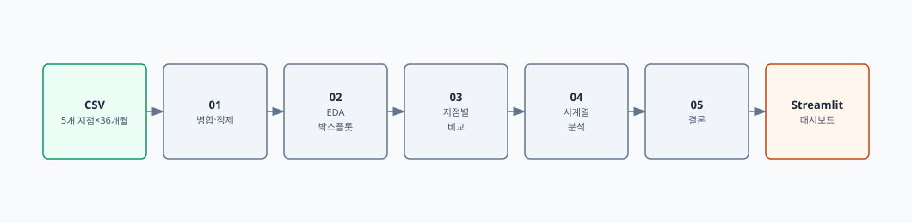
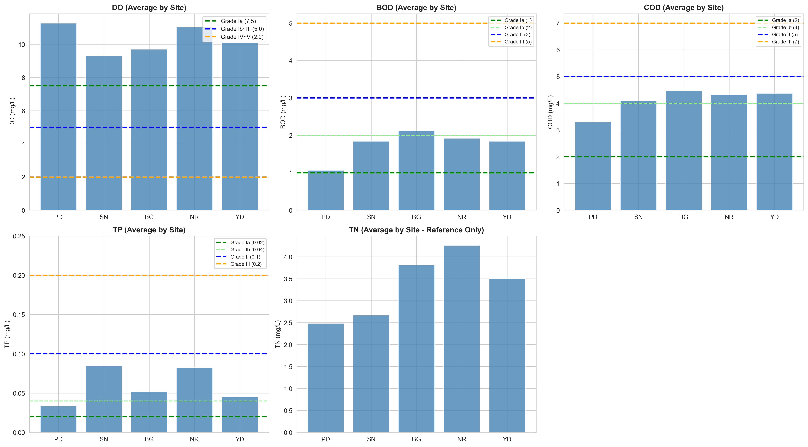

<div align="center">

# 한강 수질 오염 분석

pandas·Plotly·Streamlit을 활용한 **환경 정형 데이터 분석 프로젝트**

`Python` · `pandas` · `Plotly` · `Matplotlib` · `Streamlit` · `Jupyter Notebook`


</div>

---

## 1. 프로젝트 개요

- **배경:** 환경 데이터에서 공간적(지점별)·시간적(시계열) 패턴을 함께 분석하는 연습 필요 — 환경부 물환경정보시스템 한강 수계 공개 데이터 활용
- **목표:** 상류→지류→중류→하류 흐름에서 수질이 어느 지점에서, 얼마나 달라지는지 EDA → 비교 → 시계열 분석으로 단계적 검증
- **기간:** 2026.06 – 2026.11
- **규모:** 5개 지점 × 36개월 · 측정 항목 5개(DO·BOD·COD·TP·TN) · 노트북 4개

| 영역 | 기술 | 사용 이유 |
| --- | --- | --- |
| 데이터 처리 | pandas | CSV 병합, 결측치 제거, 균등화 |
| 시각화 | Plotly, Matplotlib, seaborn | 인터랙티브 대시보드 + 정적 분석 그래프 |
| 대시보드 | Streamlit | 분석 결과 시각화 웹 앱 |
| 분석 환경 | Jupyter Notebook | 단계별 분석 기록 및 재현 가능 구성 |

**분석 파이프라인**

<p align="center">
  
</p>

**데이터 구조**

```
5개 지점 × 36개월 × 5개 항목 (DO · BOD · COD · TP · TN)
1행 = 1개 지점의 1개월 측정 평균값
```

---

## 2. 주요 결과 화면

| 지점별 수질 지표 분포 (박스플롯) | 지점별 평균값 비교 (바차트) |
| --- | --- |
|  |  |
| ① 5개 지점·5개 지표 분포 및 이상치 파악 | ② 상류→지류→중류→하류 평균값 흐름 비교 |

---

## 3. 구현 내용

### 3-1. 데이터 전처리

- 5개 지점 CSV 병합, 결측치 제거
- **균등화:** 5개 지점 모두 측정된 월만 사용 (보간 미적용)
- 환경기준(Ⅰ~Ⅴ등급) 적용 → 등급 초과 지점 별도 표기

### 3-2. EDA (박스플롯)

- 지점별 오염도 분포 및 이상치 파악
- 성내천(지류)이 전 지표에서 가장 높은 오염도 확인

### 3-3. 지점별 비교 (바차트)

- 상류→지류→중류→하류 평균값 바차트 시각화
- TN: 상류(팔당댐2) 2.48 mg/L → 하류(영등포) 4.26 mg/L (약 1.7배 누적)

### 3-4. 시계열 분석

- 월별(36개월)·계절별(4계절)·년도별(3년) 변화 추이 분석
- 계절 변동이 수질 차이의 주요 원인 — 여름 DO 13~15 mg/L, 겨울 5~8 mg/L (약 2~2.5배 차이)

| 계절 | DO | BOD | 특징 |
| --- | --- | --- | --- |
| 여름 | 13~15 mg/L | 0.8~1.2 mg/L | 최고 수질 |
| 봄 | 11~12 mg/L | 1.3~1.5 mg/L | 중간 |
| 가을 | 10~11 mg/L | 1.5~1.8 mg/L | 악화 추세 |
| 겨울 | 5~8 mg/L | 2.0~2.5 mg/L | 최저 수질 |

---

## 4. 문제 해결 경험

### 1) 계절 효과가 지점별 평균 비교를 가림

- **문제:** 지점별 평균값만 비교하면 계절 편향이 개입 — 계절별 측정 불균등이 있으면 지점 차이가 왜곡될 수 있음
- **원인 분석:** 단순 평균은 계절 분포를 고려하지 않음
- **해결:** 지점별 비교와 시계열 분석을 별도 단계로 분리, 두 축을 각각 명확히 해석

### 2) 균등화 기준 수립

- **문제:** 지점별 측정 결측 월이 다르면 비교 시 샘플 불일치 발생
- **원인 분석:** 결측 보간 없이 비교하면 지점별 모수 차이가 발생
- **해결:** 5개 지점 모두 측정된 월만 사용(균등화), 보간 미적용으로 임의 추정 제거

### 3) 환경기준 미적용 시 수치 맥락 부재

- **문제:** DO·BOD 수치만으로 "양호한지"를 판단하기 어려움
- **원인 분석:** 절대 수치 없이는 오염 정도를 상대적으로만 비교 가능
- **해결:** 한국 수질 오염 등급(Ⅰ~Ⅴ) 기준 도입, 등급 초과 지점 별도 표기
- **결과:** DO·BOD는 전 지점 Ⅱ등급 이내로 양호, TP·TN 하류 주의 구간 확인

---

## 5. 한계와 개선 방향

- **외부 요인 미포함:** 강우량·기온 데이터 없어 계절 변동 원인은 추정에 그침
- **단기 이벤트 포착 불가:** 월평균 집계로 강우 직후 급증 등 포착 한계
- **성내천 오염 원인 불명:** 인근 하수 처리·산업 시설 등은 이 데이터만으로 확인 불가
- **개선 방향:** 강우량·기온 연계 분석, 단기 측정 주기 데이터 확보

---

<details>
<summary><b>실행 방법과 파일 구조</b></summary>

<br />

```bash
git clone https://github.com/Jenny5789/hangang-water-quality.git
cd hangang-water-quality
python -m venv venv
source venv/bin/activate       # Mac/Linux
.\venv\Scripts\activate.bat    # Windows
pip install -r requirements.txt
```

노트북은 앞 단계 저장 파일을 읽으므로 01부터 순서대로 실행

| 순서 | 파일 | 내용 |
| --- | --- | --- |
| 1 | 01_data_merges.ipynb | 데이터 병합·정제 |
| 2 | 02_eda_boxplot.ipynb | EDA 박스플롯 분석 |
| 3 | 03_comparison.ipynb | 지점별 평균값 비교 |
| 4 | 04_timeseries.ipynb | 시계열 분석 |

**Streamlit 대시보드**

```bash
streamlit run outputs/app.py
```

```
hangang-water-quality/
├── 01_data_merges.ipynb
├── 02_eda_boxplot.ipynb
├── 03_comparison.ipynb
├── 04_timeseries.ipynb
├── 05_conclusion.txt
├── data/processed/
├── outputs/
│   ├── app.py
│   ├── 02_5indicators_boxplot.png
│   └── 03_comparison_barchart.png
└── requirements.txt
```

</details>

---

## 6. 프로젝트를 통해 얻은 경험

- **공간·시간 분리:** 지점별 비교와 시계열 분석을 두 축으로 명확히 구분해야 해석 정확도 확보
- **외부 기준 활용:** 환경기준(Ⅰ~Ⅴ등급) 도입으로 수치 맥락 확보 — 절대 기준 없이는 상대 비교만 가능
- **전처리 기준 명시:** 결측치 처리 방식(균등화, 보간 미적용)을 단계별로 문서화해 재현 가능한 분석 구성
